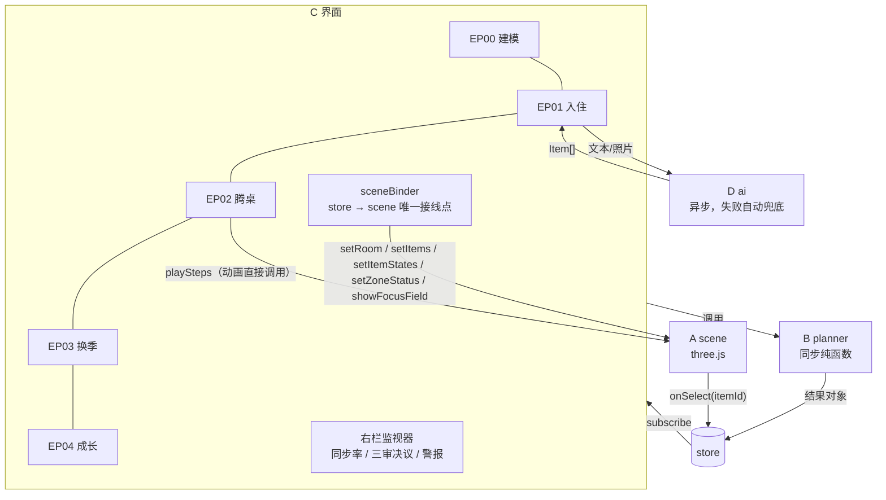
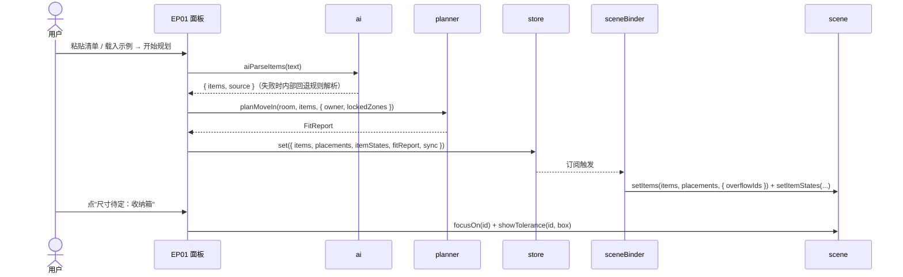
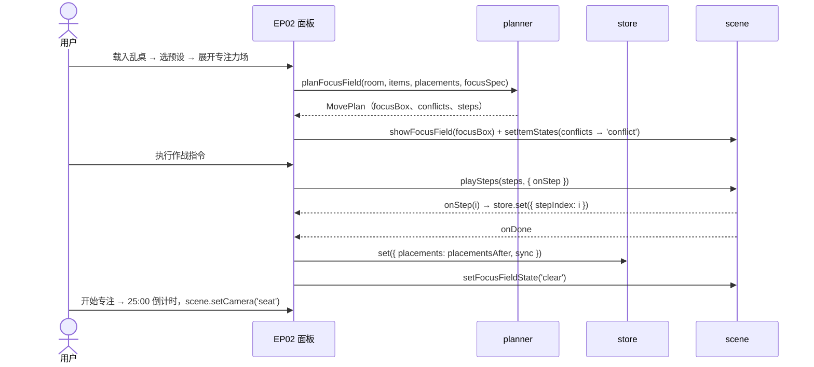

# 03 · 系统架构

> 读者：所有车道。本文件定义模块边界、公开 API、状态仓库和关键时序。
> 数据结构的字段定义见 `04-data-contract.md`，算法细节见 `05-algorithms.md`。

## 1. 技术选型

| 选择 | 理由 |
|---|---|
| 浏览器单页应用 + Vite 6 | 现场只需一台电脑开浏览器演示；热更新快；Node 18 也能跑 |
| 原生 JavaScript ES Modules + JSDoc | 四条车道并行开发，没有框架耦合；AI 生成代码更稳 |
| three.js 0.186 | 线框加发光正好是 EVA 作战屏的质感。家具和物品全部是**参数化盒子**，不需要外部 3D 模型 |
| @fontsource 本地字体 | 不依赖 Google Fonts（现场网络未必能访问），离线可用，OFL 许可可随作品开源 |
| vite 开发服务器代理 AI 请求 | API key 不进浏览器，满足"API 不得放入源码"的赛规 |
| node:test | 不需要额外安装依赖的单测框架，B 车道用 |

> 为什么用盒子："3D 建模"在这里是**参数化建模**：宿舍模板参数经 `buildRoom()` 生成几何，物品是带尺寸的盒子。这是刻意的"作战蓝图"风格，也是唯一能在一个下午做完、且尺寸完全可信的方案。

## 2. 目录结构

方括号里是归属车道。只有每个模块的 `index.js` 对外暴露的 API 是固定的，其余文件名是建议。

```
dormArrange/
├─ index.html                        [C]
├─ vite.config.js                    [D] AI 代理 + /ai/__config
├─ package.json                      [C]
├─ src/
│  ├─ main.js                        [C] 入口：开机序列 → 外壳 → 接线
│  ├─ core/
│  │  ├─ types.js                    [B] JSDoc 类型 = 契约的代码版
│  │  └─ store.js                    [C] 状态仓库（发布/订阅）
│  ├─ data/                          [B]
│  │  ├─ roomTemplates.js            DEFAULT_PARAMS、buildRoom(params)
│  │  ├─ itemLibrary.js              LIBRARY、makeItem(libId, overrides)
│  │  ├─ rules.js                    RULES（清华学生公寓违章电器）
│  │  └─ demoPresets.js              PRESETS.freshman / messyDesk / growth
│  ├─ planner/                       [B] 全部是纯函数
│  │  ├─ index.js                    ★ 公开 API（§4.1）
│  │  ├─ geometry.js                 盒子运算、分区局部坐标
│  │  ├─ heightmap.js                2.5D 高度图放置引擎
│  │  ├─ hang.js                     挂杆一维装箱
│  │  ├─ engines.js                  为整间宿舍建引擎集合
│  │  ├─ rank.js                     候选分区排序、类别亲和表
│  │  ├─ moveIn.js                   EP01 入住
│  │  ├─ focusField.js               EP02 腾桌
│  │  ├─ seasons.js                  EP03 时分复用
│  │  ├─ sync.js                     同步率、三审决议
│  │  ├─ parseText.js                规则文本解析（AI 的离线兜底）
│  │  └─ growth.js                   成长预测（加分）
│  ├─ scene/                         [A]
│  │  ├─ index.js                    ★ createScene → Scene API（§4.2）
│  │  ├─ roomView.js  itemView.js  zoneView.js
│  │  ├─ cameraRig.js  animator.js  effects.js  textures.js
│  │  └─ __mock__.js                 自测用示例数据
│  ├─ ui/                            [C]
│  │  ├─ shell.js  boot.js  titleCard.js  sceneBinder.js
│  │  ├─ panels/  ep00Model.js ep01MoveIn.js ep02Focus.js ep03Seasons.js ep04Growth.js
│  │  └─ widgets/ syncGauge.js tribunal.js alerts.js heatmap.js timeline.js focusTimer.js
│  ├─ styles/                        [C] tokens.css  eva.css
│  └─ ai/                            [D]
│     ├─ index.js                    ★ 公开 API（§4.3）
│     ├─ client.js                   chat / responses 两种协议
│     └─ prompts.js                  产品运行时用的提示词
├─ tests/                            [B] *.test.js
├─ docs/  tasks/  submission/  assets/
```

## 3. 数据流



规则如下：

- **面板只做三件事**：调用 planner 或 ai、把结果写进 store、播放动画。
- **`sceneBinder.js` 是 store → scene 的唯一接线点**：订阅相关 key，调用 scene 的 set* 方法。这样避免多个面板各自操作场景、互相打架。
- **planner 只接收数据、只返回新对象**，不修改入参。

## 4. 模块公开 API（★ 固定，改动需先改本文件）

### 4.1 planner — `src/planner/index.js`

```js
// —— 数据与常量（从 data/ 再导出）——
export { DEFAULT_PARAMS, buildRoom } from '../data/roomTemplates.js';
export { LIBRARY, makeItem } from '../data/itemLibrary.js';
export { RULES } from '../data/rules.js';
export { PRESETS } from '../data/demoPresets.js';

/** EP01：规划新生带来的物品放在哪 */
export function planMoveIn(room, items, opts = {}) {}
// opts: { owner = 'A', lockedZones = [], existing = {} /* 已有 placements（室友的东西等），不可动 */ }
// → FitReport

/** EP02：腾出专注区（最少移动） */
export function planFocusField(room, items, placements, focusSpec, opts = {}) {}
// focusSpec: { zoneId = 'A.desk', w = 75, d = 35 }
// opts: { lockedZones = [], maxCascade = 1, allowUpgrades = false }
// → MovePlan

/** EP02 辅助：把前 upto 步应用到 placements 上（UI 拖动步骤条时用） */
export function applySteps(placements, steps, upto = steps.length) {}   // → placements

/** EP03：时分复用换季规划 */
export function planSeasons(room, items, opts = {}) {}
// opts: { owner = 'A', tdm = true, months = [9,10,11,12,1,2,3,4,5,6,7,8], compare = true }
// → TdmPlan

/** EP03 辅助：两个月之间的换季步骤 */
export function diffMonths(monthPlanA, monthPlanB, items, room) {}       // → MoveStep[]

/** 同步率与三审决议 */
export function computeSync(room, items, placements, ctx = {}) {}
// ctx: { owner = 'A', focusBox, moves, decisions, swaps } → SyncReport

/** 各分区占用率 0..1（挂杆按长度，其余按体积） */
export function zoneFill(room, items, placements) {}                     // → Record<zoneId, number>

/** 规则文本解析（AI 的离线兜底） */
export function parseItemsText(text, opts = {}) {}                       // opts: { owner = 'A', idPrefix = 'it' } → Item[]

/** 违章电器检查 */
export function checkRules(item) {}                                      // → { banned, ruleId?, reason?, warn? }

/** 加分：成长预测 */
export function predictGrowth(items, room, opts = {}) {}                 // → GrowthForecast
```

### 4.2 scene — `src/scene/index.js`

```js
export function createScene(container, { onSelect, onHover } = {}) {
  return {
    setRoom(room),                              // 重建墙、门窗、固定家具、分区
    setZoneStatus(map),                         // Record<zoneId, 'empty'|'designing'|'done'>
    setItems(items, placements, opts),          // opts: { animate = true, overflowIds = [] }；无 placement 的物品进滞留区
    setItemStates(map),                         // Record<itemId, ItemVisualState>（见 docs/04 §7）
    showTolerance(itemId, box),                 // box = null 表示清除
    showFocusField(box),                        // box = null 表示清除
    setFocusFieldState(state),                  // 'conflict' | 'clear'
    playSteps(steps, { stepMs = 900, onStep, onDone }),   // → { pause, resume, seek(i), stop }
    setCamera(mode, { owner = 'A' }),           // 'orbit' | 'top' | 'seat'
    focusOn(id),                                // itemId 或 zoneId
    setBloom(on),                               // 加分
    snapshot(),                                 // 加分：→ dataURL
    dispose(),
  };
}
```

scene 只认 docs/04 的数据形状，**不 import planner**。需要的几何信息（例如 seat 视角要找 `A.desk`）都从 `room.zones` 里取。

### 4.3 ai — `src/ai/index.js`

```js
export async function aiAvailable() {}                        // → boolean（请求一次 /ai/__config 后缓存）
export async function aiParseItems(text, { owner = 'A' }) {}  // → { items: Item[], source: 'ai'|'rules', warnings: string[] }
export async function aiParsePhoto(file, { owner = 'A' }) {}  // → 同上；不可用时 source = 'unavailable'
export async function aiExplainPlan(movePlan) {}              // 加分：→ 一段中文解说
```

`aiParseItems` **永不抛错**：失败时内部调用 `parseItemsText` 兜底。

### 4.4 UI 面板约定（C 车道内部）

每个面板文件导出 `mount(el, ctx)` 和 `unmount()`，`ctx` 的结构：

```js
{ store, scene, planner, ai, showTitleCard, alert }
```

## 5. 状态仓库 — `src/core/store.js`

```js
const store = createStore(initialState);
store.get();                    // → 当前 state（只读）
store.set(patch);               // 浅合并，然后通知订阅者
store.subscribe(fn, keys?);     // keys 可选：只关心哪些字段变化 → 返回取消订阅函数
```

| 字段 | 类型 | 初始值 | 谁写 |
|---|---|---|---|
| episode | `'EP00'..'EP04'` | `'EP00'` | 导航 |
| owner | `'A'..'D'` | `'A'` | EP00 |
| roomParams | RoomParams | `DEFAULT_PARAMS` | EP00 |
| room | Room | `buildRoom(DEFAULT_PARAMS)` | EP00 |
| items | Item[] | `[]` | EP01 / EP02 预设 / EP04 加载 |
| placements | `Record<itemId, Placement>` | `{}` | 各话结果 |
| itemStates | `Record<itemId, ItemVisualState>` | `{}` | 各话结果 |
| lockedZones | string[] | `[]` | EP00 |
| zoneStatus | `Record<zoneId, ZoneStatus>` | 派生 | sceneBinder 计算（见下） |
| fitReport | FitReport \| null | null | EP01 |
| focusSpec | FocusSpec | `{ zoneId: 'A.desk', w: 75, d: 35 }` | EP02 |
| movePlan | MovePlan \| null | null | EP02 |
| stepIndex | number | 0 | EP02 |
| month | 1..12 | 9 | EP03 |
| tdm | boolean | true | EP03 |
| tdmPlan | TdmPlan \| null | null | EP03 |
| snapshots | Snapshot[] | `[]`，从 localStorage 恢复 | EP04 |
| focusMinutes | number | 0，从 localStorage 恢复 | 专注限界 |
| timer | `{ running, endsAt }` | `{ running: false }` | 专注限界 |
| sync | SyncReport \| null | null | 每次结果变化后重算 |
| syncHistory | `{ t, total, label }[]` | `[]` | 同上 |
| selection | string \| null | null | scene.onSelect |
| camera | `'orbit'\|'top'\|'seat'` | `'orbit'` | 视角按钮 |
| alerts | `{ id, level, text, t }[]` | `[]` | 任意面板 |
| ai | `{ available, busy, lastSource }` | `{ available: false }` | EP01 |

- **zoneStatus 派生规则**：在 `lockedZones` 里 → `done`；否则分区内有物品 → `designing`；否则 → `empty`。
- **持久化**：只把 `roomParams`、`snapshots`、`focusMinutes` 存进 localStorage，key 为 `fangcun.v1`。读写都要包 try/catch。

## 6. 关键时序

### 6.1 EP01 入住



### 6.2 EP02 腾桌



### 6.3 EP03 换季

拖动月份滑块 → 用 `tdmPlan.byMonth[m]` 更新 store 的 placements → sceneBinder 调用 `setItems(..., { animate: true })`。

同时调用 `diffMonths(prev, cur)` 生成换季清单。`planSeasons` 只在进入 EP03 或物品变化时计算一次，计算前先显示"计算中"。

### 6.4 EP04 成长

- 「保存快照」：把当前 items、placements、sync、focusMinutes 存进 snapshots。
- 「回放」：依次把相邻快照的 placements 交给 `setItems`，每段间隔 1.2s。

## 7. 性能预算

| 操作 | 预算 | 超出时 |
|---|---|---|
| `planMoveIn`（40 件） | ≤ 150ms | 大分区把高度图分辨率从 2cm 换成 5cm |
| `planFocusField` | ≤ 50ms | — |
| `planSeasons`（12 个月 × 开/关两遍） | ≤ 800ms | 放到 setTimeout 里，先渲染"计算中" |
| 渲染 | ≥ 45fps | 关闭 bloom，降低 pixelRatio |

## 8. 错误处理与降级

- **AI 不可用**（没有 key、断网或超时）：自动走规则解析。UI 只提示"AI 离线，已使用本地解析"。
- **planner 抛错**：面板捕获后推一条 error 警报，并保留上一次的结果。演示时界面绝不能白屏。
- **字体没加载完**：fallback 到系统字体，不阻塞渲染。
- **WebGL 不可用**：画布区域显示警示条和提示文字"需要支持 WebGL 的浏览器"。

## 9. 演示机配置

- Chrome 或 Edge 最新版，屏幕缩放 100%，浏览器全屏（F11）。
- 用 `npm run dev` 启动，**不要用 build 产物演示**，因为 AI 代理只在 dev server 里存在。
- 准备一段约 60 秒的录屏作为备份（docs/01 §5），防止现场出故障。
