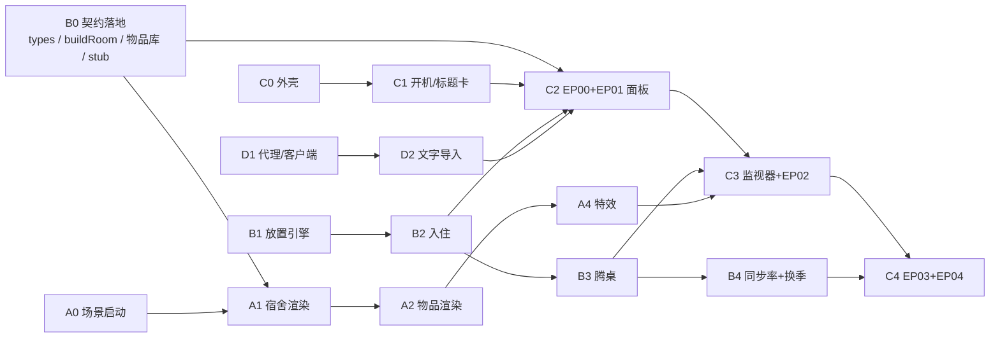

# 任务看板 · 谁做什么

> 原则：**Codex 管"看得见的"，Claude Code 管"算得对的"。** 车道按目录隔离，接口由 `docs/04-data-contract.md` 锁定。先出 stub 再实现，所以四条车道从第一分钟就能并行。

## 1. 人 × 智能体 × 车道

### 3 人队（推荐）

| 队员 | 开的窗口 | 车道 | 另外负责 |
|---|---|---|---|
| P1 | Codex ×1 | **A 3D 场景** | 3D 演示效果 |
| P2 | Codex ×1 | **C 界面外壳** | 主演示机（最终在 P2 电脑上集成和演示）、视觉风格把关 |
| P3 | Claude Code ×1 做 B；Codex ×1 做 D（B0 推送后开） | **B 规划引擎** + **D AI 与集成** | 路演讲解、提交材料 |

### 2 人队

| 队员 | 开的窗口 | 车道 |
|---|---|---|
| P1 | Codex ×2（同时开） | 先 C0→C1，再并行 A；之后 C2–C4 |
| P2 | Claude Code ×2 | B 全部 + D 全部 + 提交材料 |

- 全队 API 并发不要超过 5：一个 Codex 窗口约占 1 个并发。
- 每人在**自己的电脑**上 clone 本仓库，各自 `npm install`。只有主演示机和 D 车道的电脑需要 `.env.local`。

## 2. 开工步骤（每人照做）

1. `git clone https://github.com/NeedleAss/dormArrange.git && cd dormArrange && npm install`
2. 打开你的智能体（Codex 或 Claude Code），工作目录就是仓库根目录。智能体会自动读取 AGENTS.md / CLAUDE.md。
3. 用你自己的话告诉它三件事：
   - 它是哪条车道
   - 先读 `tasks/<车道>.md`
   - 从第一个没勾选的任务开始做，做完一个提交一个
4. 盯住它的改动。只要看到它去改别的车道的文件，立刻叫停。

> 赛规要求开发提示词在现场构思并输入：上面只写了要表达的意思，请自己组织语言输入。

## 3. 依赖顺序

A0、B0、C0、D1 互不依赖，可以同时开工。

## 4. 时间线（北京时间）

> ⚠️ **16:20 更新：截止延到 18:00。以 AGENTS.md §8 的新检查点为准，下表是原计划，仅供参考。**

| 时间 | A 3D（Codex） | B 规划（Claude Code） | C 界面（Codex） | D AI（Codex） |
|---|---|---|---|---|
| 14:30–14:50 | A0、A1 | **B0（14:40 前推送）**、B1 | C0、C1 | D1 |
| 14:50 **CP0** | 能渲染宿舍 | stub 可用 | 外壳可用 | 代理可用 |
| 14:50–15:20 | A2、A3 | B1、B5 前半（解析 + 新生预设）、B2 | C2 | D2 |
| 15:20 **CP1** | — | 入住算法 | 入住面板 | 文字导入 |
| 15:20–15:55 | A4 | B3（+ 乱桌预设） | C3 | D3（可选） |
| 15:55 **CP2 核心冻结** | — | 腾桌算法 | 腾桌面板 | — |
| 15:55–16:20 | A5 | B4（+ 成长预设） | C4、C5 | D4 集成走查 |
| 16:20–16:35 | 修 bug | 修 bug | 修 bug + 彩排 | 写 README、整理提交材料 |
| 16:35 | **保底上传** | | | |
| 16:55 | **最终上传** | | | |

## 5. 状态（各车道自己勾选）

- A：A0 [ ] A1 [ ] A2 [ ] A3 [ ] A4 [ ] A5 [ ]
- B：B0 [ ] B1 [ ] B2 [ ] B3 [ ] B4 [ ] B5 [ ] B6 [ ]
- C：C0 [ ] C1 [ ] C2 [ ] C3 [ ] C4 [ ] C5 [ ]
- D：D1 [ ] D2 [ ] D3 [ ] D4 [ ]

## 6. 落后时按这个顺序砍

1. D3 照片导入
2. B6 加购方案和成长预测
3. A5 发光后期
4. C5 待机演示
5. EP04 只做"预设快照 + 时间轴点击"，不做回放
6. EP03 只做 4 个季节，不做 12 个月

**EP00、EP01、EP02 不能砍。**
